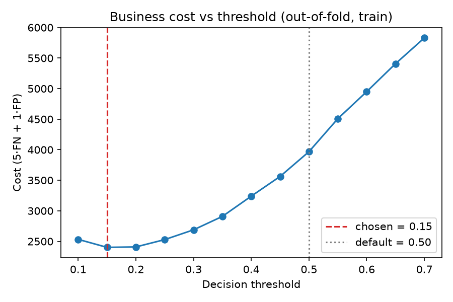
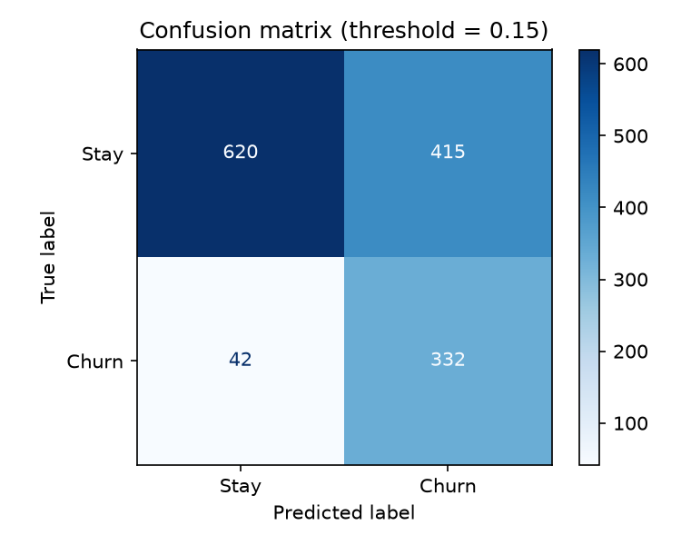
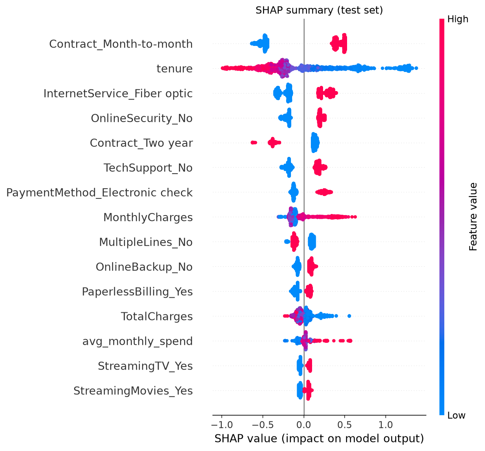

# Telecom Customer Churn Prediction

Predicting which telecom customers are about to leave, explaining **why**, and choosing a decision threshold based on **business cost** instead of the default 0.5.

**Highlights**
- **Test ROC-AUC 0.846** with a tuned Gradient Boosting model inside a leakage-safe scikit-learn `Pipeline`
- A cost-based threshold (0.15) raises **churner recall from 50% → 89%** and **cuts expected cost by 39%** compared with the default 0.5
- **SHAP** explainability: the top churn drivers are **contract type, tenure and internet service**

---

## Problem

Acquiring a new customer costs far more than keeping an existing one. The goal is to flag likely churners early so the retention team can step in, and to explain which factors drive churn so the business can act on them.

## Dataset

[Telco Customer Churn](https://www.kaggle.com/datasets/blastchar/telco-customer-churn) (IBM sample data, by blastchar on Kaggle): 7,043 customers, 20 features (demographics, account info and subscribed services), and a binary `Churn` target.

The classes are **imbalanced (73% stay / 27% churn)**. A model that always predicts "stay" gets 73% accuracy while catching no churners, so models are evaluated on **ROC-AUC** and **churner recall**, not accuracy.

## Approach

| Step | What & why |
|---|---|
| **Cleaning** | `TotalCharges` was stored as text, and 11 blank values all belong to `tenure == 0` customers who haven't been billed yet, so they were filled with **0**. Dropped `customerID` and encoded `Churn` as 1/0. |
| **EDA** | Churn rate by contract, tenure, internet service, payment method and monthly charges ([notebook](notebooks/02_eda.ipynb)). |
| **Feature engineering** | `tenure_group` (0–12 / 12–24 / 24–48 / 48+), `num_services` (count of subscribed services), `avg_monthly_spend = TotalCharges / (tenure + 1)` (the +1 avoids dividing by zero). |
| **Split** | 80/20 `train_test_split` with `stratify=y` to keep the class ratio. |
| **Pipeline** | `ColumnTransformer` (StandardScaler for numeric columns + OneHotEncoder for categorical ones) → model, all in one `Pipeline`, so preprocessing is fit only on training folds (**no data leakage**). |
| **Model selection** | Logistic Regression, Random Forest (`class_weight='balanced'`) and Gradient Boosting, compared with 5-fold stratified CV on ROC-AUC, then a small `GridSearchCV` for each. |
| **Threshold tuning** | Assumes a missed churner costs 5× a retention offer. Minimizes `5·FN + 1·FP` on **out-of-fold training predictions**, so the test set stays untouched. |
| **Explainability** | `shap.TreeExplainer` on the final model, with one-hot columns grouped back to their original features. |

## Results

### Model comparison (5-fold CV ROC-AUC on the training set)

| Model | Baseline CV ROC-AUC | Tuned CV ROC-AUC |
|---|---|---|
| **Gradient Boosting** | 0.847 ± 0.011 | **0.850** |
| Logistic Regression (balanced) | 0.848 ± 0.012 | 0.848 |
| Random Forest (balanced) | 0.825 ± 0.012 | 0.848 |

Selected model: **Gradient Boosting** (`n_estimators=200, learning_rate=0.05, max_depth=2`).

### Held-out test set (1,409 customers)

**Test ROC-AUC: 0.846**

| Threshold | Churn precision | Churn recall | Accuracy | Business cost (5·FN + FP) |
|---|---|---|---|---|
| 0.50 (default) | 0.67 | 0.50 | 0.80 | 1023 |
| **0.15 (cost-optimal)** | 0.44 | **0.89** | 0.68 | **625 (−39%)** |

Accuracy drops at the tuned threshold, which is expected and fine: missing a churner is far more expensive than sending an unnecessary retention offer.

<p>
  
  
</p>

### Top churn drivers (SHAP)

1. **Contract type**: month-to-month customers churn at 43%, versus 3% on two-year contracts
2. **Tenure**: risk is highest in the first 12 months (47% churn)
3. **Internet service**: fiber-optic customers churn at 42%, versus 19% on DSL

These are followed by missing **Online Security / Tech Support** and paying by **electronic check** (45% churn).



### Business recommendations

- Offer incentives to move month-to-month customers onto 1–2 year contracts.
- Focus retention effort on the first year (onboarding, early check-ins).
- Look into fiber-optic pricing and service quality.
- Bundle security and tech-support add-ons, and promote automatic payment.

## Project structure

```
├── data/
│   ├── raw/                 # Telco-Customer-Churn.csv (not committed; download from Kaggle)
│   └── processed/           # cleaned data (generated)
├── notebooks/
│   ├── 01_data_cleaning.ipynb
│   ├── 02_eda.ipynb
│   └── 03_modeling.ipynb    # step-by-step walkthrough of train.py
├── reports/
│   ├── figures/             # all plots used above
│   └── metrics.json         # full results written by train.py
├── src/
│   ├── data_cleaning.py     # load + clean (shared by notebooks and train.py)
│   ├── features.py          # feature engineering + column lists
│   └── eda.py               # quick text summary of the raw data
├── train.py                 # end-to-end training, evaluation, SHAP
└── requirements.txt
```

## How to run

```bash
git clone https://github.com/DevanshJhaNSIT/Telcom-Churn-Prediction.git
cd Telcom-Churn-Prediction
python -m venv .venv && source .venv/bin/activate
pip install -r requirements.txt
```

Download `WA_Fn-UseC_-Telco-Customer-Churn.csv` from [Kaggle](https://www.kaggle.com/datasets/blastchar/telco-customer-churn) and save it as `data/raw/Telco-Customer-Churn.csv`. Then run:

```bash
python train.py          # trains, evaluates, writes reports/ and models/
jupyter notebook         # explore notebooks/ 01 → 03
```

## Tech stack

Python · pandas · NumPy · scikit-learn · SHAP · matplotlib · seaborn · Jupyter
